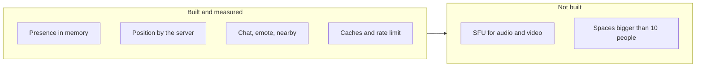
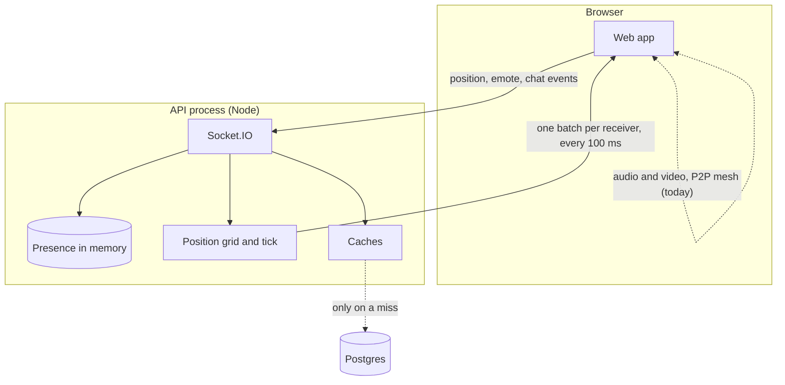
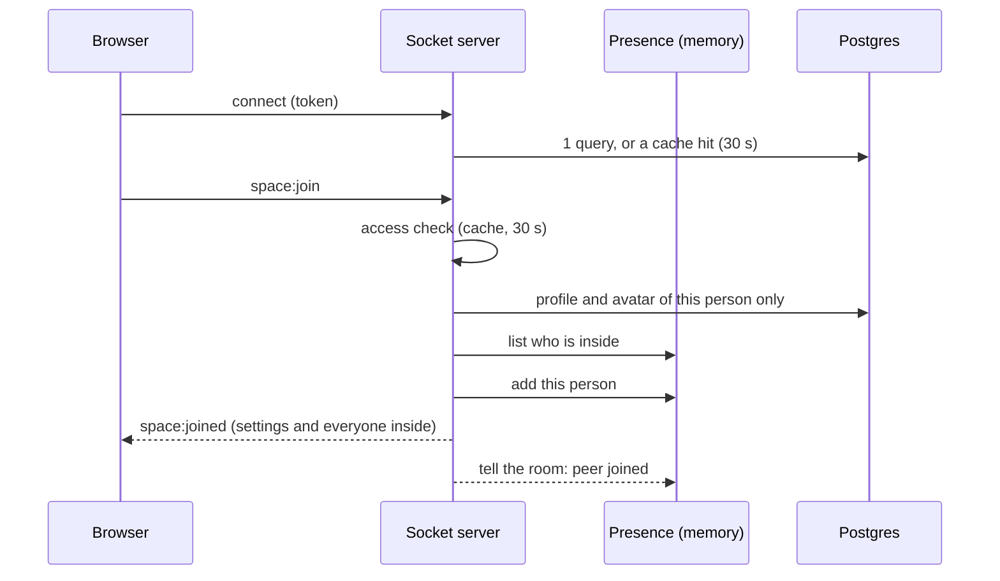
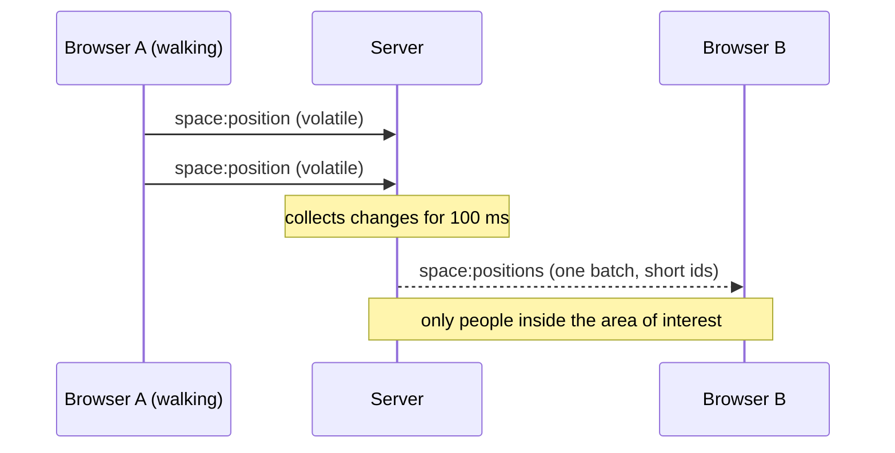
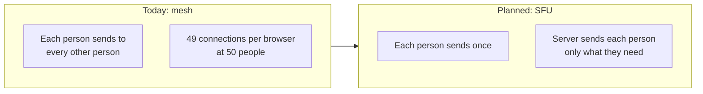
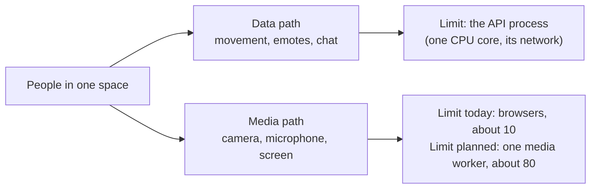

The load test is in `apps/api/src/scripts/loadtest/`. It has no script in
`package.json`, so it is started directly. Start the API in development and
open the space in a browser. Then, from `apps/api`:

# Performance and capacity guide

How the realtime side of a space works, how much it costs, and where the
limits are. The tested target is **one space with up to 50 people at once**. Section 6
explains how far it goes beyond that and how to size a server for it.

This page is for people who run, size or change the system. Every number says
where it comes from:

| Tag           | Meaning                                                                                              |
| ------------- | ---------------------------------------------------------------------------------------------------- |
| **Measured**  | Read from a run of the load test on a development machine.                                           |
| **Code**      | A constant in the code. It is exact.                                                                 |
| **Estimate**  | A projection from the code, public benchmarks or research on similar products. Nothing measured yet. |
| **Not built** | The feature does not exist yet. The number is a goal.                                                |

## 1. Where we are

The server side is ready for 50 people. The **audio and video are not**.



| Area                                    | State                                   | Why it matters                                                            |
| --------------------------------------- | --------------------------------------- | ------------------------------------------------------------------------- |
| Joining a space                         | Done and measured                       | 50 people join together in under 60 ms (p99)                              |
| Position, emote, nearby message, typing | Done and measured                       | Goes through the server, not between browsers                             |
| Chat, edits, deletes, reactions         | Done                                    | The server sends them after they are saved                                |
| Audio and video                         | **Through a media server (SFU)**, built | Measured with synthetic senders, not yet with real browsers (section 4.7) |
| Space size                              | **`MAX_SPACE_CAPACITY = 80`** (Code)    | The M, L and XL space sizes are enabled                                   |

**In one sentence:** a space can hold 50 people moving, chatting and emoting
today, and the media server forwards the audio and video of that many people.
The numbers for the media server come from synthetic senders on one machine
(section 4.7). They still have to be confirmed with real browsers on a real
server (section 6.6).

## 2. How it works

### 2.1 The three paths



1. **Data path (done).** Position, emotes, nearby messages, typing and chat go
   browser, then server, then the other browsers. The server decides who
   hears what.
2. **Database path (done).** The database is read when a person joins and
   when a cache expires. Walking around costs **zero queries**.
3. **Media path (built).** Each browser sends its audio and video once to the
   media server inside the API, and the server forwards them to the people
   the planner chose (section 4.7).

### 2.2 Joining a space

Before, every join read the profile and avatar of every person already inside
(about 150 queries each, 7,500 when 50 joined together). Now the server keeps
who is inside in memory and reads only the person who is joining.



|                             | Before                     | Now                                                 |
| --------------------------- | -------------------------- | --------------------------------------------------- |
| Queries per join            | about 150 (Estimate)       | **7** (Measured, 6 in the join and 1 for the token) |
| 50 people joining together  | about 7,500 (Estimate)     | **350** (Measured)                                  |
| Queries while people walk   | n/a                        | **0** (Measured)                                    |
| Avatar images built at join | yes, can use 100 to 300 MB | **never**. They are built when the avatar is edited |

### 2.3 Moving around

The browser sends its position at most every **80 ms** and only if it changed.
The server does not forward each one. It collects them and sends one batch per
receiver every **100 ms**.



What keeps this cheap:

- **Only changes are sent.** A person standing still costs nothing.
- **Short numeric ids** instead of 20-character socket ids cut the position
  traffic by 54% (Measured).
- **Area of interest.** A person only hears about others within **3,000 px**,
  plus a 200 px margin so someone on the border does not flicker (Code).
  On a small map this covers everyone, so the real saving there comes from
  batching and from sending only changes.
- **Volatile.** A position that cannot be delivered is dropped. A slow client
  never builds a queue.
- **Reliable where it matters.** The first position after joining, and a
  person entering or leaving view, are not dropped.

### 2.4 Emotes, nearby messages and chat

| Event                                | Who receives it                                                          | Notes                                                                                                      |
| ------------------------------------ | ------------------------------------------------------------------------ | ---------------------------------------------------------------------------------------------------------- |
| Emote, nearby message, nearby typing | People within **640 px** and in the **same private rooms** as the sender | One packet is encoded once for all receivers                                                               |
| Chat message, edit, delete, reaction | People in the conversation                                               | Sent by the server **after** the message is saved. Carries each person's unread count, so no one refetches |
| Chat typing                          | People in the conversation                                               | The server checks the sender may be in it                                                                  |

Chat events go to a separate room, `notify:<user>`, that only the app-wide
connection joins. Each person has two connections (the app and the space) and
this avoids sending every chat event twice.

### 2.5 What is cached, and for how long

A cache is a trade: fewer queries in exchange for a short window where the
answer can be old. Every window below is short on purpose, and the events that
change the answer empty the cache right away.

| Cache                            | Lifetime         | Max entries | Emptied by                                      |
| -------------------------------- | ---------------- | ----------- | ----------------------------------------------- |
| Signed-in user                   | 30 s             | 5,000       | Rename, profile picture, delete, member removed |
| Space access (who may join)      | 30 s             | 10,000      | Any guest event, member removed                 |
| Conversation recipients (typing) | 10 s             | 2,000       | Expiry only                                     |
| Space to organization            | 60 s             | 5,000       | Never changes for a space                       |
| Who is in each space             | until they leave | n/a         | Join, leave, disconnect                         |

The worst case for a stale answer is **30 seconds**. A guest whose pass ends
while joining is checked again against the database, with no cache, once they
are inside.

## 3. Limits you can rely on

### 3.1 Rate limits per connection

A connection that goes over a limit has the extra events dropped. Events that
wait for an answer get a refusal, so the browser does not hang. Every event
without its own limit shares one bucket (30 per second, burst 60).

| Event                                              | Per second | Burst    |
| -------------------------------------------------- | ---------- | -------- |
| `space:join`                                       | 1          | 5        |
| `space:position`                                   | 20         | 40       |
| `space:emote`                                      | 8          | 16       |
| `space:nearby-message`                             | 3          | 6        |
| `space:nearby-typing`                              | 4          | 8        |
| `chat:typing`                                      | 4          | 8        |
| `webrtc:signal`                                    | 100        | 300      |
| Door events (crossed, open, present, lock, unlock) | 2 to 5     | 10 to 20 |
| Door join request and answer                       | 1 and 5    | 5 and 20 |
| Map editor lock (acquire, release, heartbeat)      | 1 to 2     | 5        |

### 3.2 Other constants (Code)

| Constant             | Value                                                                              | What it controls                     |
| -------------------- | ---------------------------------------------------------------------------------- | ------------------------------------ |
| Server tick          | 100 ms                                                                             | How often position batches go out    |
| Client send interval | 80 ms (about 12.5 per second)                                                      | Fastest a browser sends its position |
| Area of interest     | 3,000 px + 200 px margin                                                           | Who is told about whom               |
| Event radius         | 640 px                                                                             | Reach of emotes and nearby messages  |
| World limit          | 100,000 px                                                                         | Positions beyond it are refused      |
| Postgres pool        | 20 (`DATABASE_POOL_MAX`)                                                           | Connections to the database          |
| Audible radius       | From the space preset: Long 384 px (kept to 414 px), Short 160 px (kept to 190 px) | Where audio and video start and stop |
| Space size limit     | 80 people (`MAX_SPACE_CAPACITY`)                                                   | Tiers above it are disabled          |
| Media tick           | 250 ms                                                                             | How often the planner runs           |
| Loudest speakers     | 4                                                                                  | Voices a person hears at once        |
| Videos at once       | 2                                                                                  | The carousel size of a person        |

### 3.3 What is not checked

- **Speed.** The server does not reject a position that is too far from the
  last one, because sitting legitimately teleports. Only the world limit and
  the rate limit apply.
- **Walls.** Collision is checked only in the browser. A modified browser could
  walk through a locked room. Treat this as a security topic, not a
  performance one.

## 4. Measured results

All runs: 50 bots, one machine, API and database on the same host, 0 errors.
The bots chat and emote far more often than people do (a message every 4 to
10 s and an emote every 5 to 12 s), and the map is small (24 x 16 tiles), so
**everyone sees everyone**. This is a worst case for traffic.

### 4.1 Latest runs

|                               | 70% walking, 60 s | 100% walking, 20 s |
| ----------------------------- | ----------------- | ------------------ |
| Joined / errors               | 50 / 0            | 50 / 0             |
| Join time p50 / p99           | 43.5 / 57.5 ms    | 40.9 / 57.0 ms     |
| Messages received, total      | 1,065 per second  | 1,027 per second   |
| Data received, total          | 177.9 KB/s        | 232.0 KB/s         |
| API memory (start, peak, end) | 185, 188, 187 MB  | 187, 188, 182 MB   |
| API CPU                       | 2.9% of one core  | 2.9% of one core   |

Memory stayed flat during the whole run, so there is no sign of a leak.

### 4.2 What the traffic is made of (100% walking)

```
Share of messages                      Share of bytes
positions   ████████████████████ 48%   positions   ████████████████████████████████ 81%
nearby msg  ████████████ 28%           nearby msg  ████ 11%
emotes      █████████ 23%              emotes      ███ 8%
```

| Event                  | Messages per s | KB/s  | Bytes per message |
| ---------------------- | -------------- | ----- | ----------------- |
| `space:positions`      | 497            | 188.3 | 388               |
| `space:nearby-message` | 289            | 25.4  | 90                |
| `space:emote`          | 237            | 18.0  | 78                |
| Everything else        | about 4        | 0.4   | n/a               |

Positions are exactly **50 receivers x 10 ticks per second = 500 messages per
second**. That is the ceiling of the design for 50 people, however much they
move.

### 4.3 How it grows with the number of people (70% walking, earlier run)

This run is from before the short ids and before the bots walked on the real
map, so its KB/s and message counts are not comparable with section 4.1. Use it
for the shape of the growth, not for the absolute values.

| People | Join p50 / p99 | Messages per s | KB/s  | Queries for everyone to join |
| ------ | -------------- | -------------- | ----- | ---------------------------- |
| 10     | 14.4 / 16.8 ms | 105            | 17.3  | 70                           |
| 25     | 26.4 / 32.0 ms | 289            | 113.7 | 175                          |
| 50     | 54.5 / 68.7 ms | 637            | 385.4 | 350                          |

The join time grows about in line with the number of people because they all
arrive in the same second and the 20 database connections take turns. It stays
far below the 500 ms goal.

### 4.4 Per person

Divide the totals by 50 (100% walking run): about **4.6 KB/s (37 kbps)**
received per person, of which positions are about 3.8 KB/s (30 kbps). Real use
should be lower, because people stand still, talk less and see fewer people on
a bigger map.

### 4.5 Limits of these numbers

- One run per setting. There is no variance yet. Two runs with the same
  settings differed by about 8% in total traffic.
- Bots send no audio or video.
- Everything runs on one machine over loopback, so the network is not tested.
- Nothing was measured in a real browser yet (memory, frame time, audio
  contexts).

### 4.6 200 people (100% walking, 20 s, one run)

Same setup as 4.1 with 200 bots. 200 of 200 joined, 0 errors.

|                               | 50 people (4.1)  | 200 people             |
| ----------------------------- | ---------------- | ---------------------- |
| Join time p50 / p99           | 40.9 / 57.0 ms   | 167.5 / 265.8 ms       |
| Messages received, total      | 1,027 per second | 10,197 per second      |
| Data received, total          | 232.0 KB/s       | 3,157.8 KB/s (25 Mbps) |
| API memory (start, peak, end) | 187, 188, 182 MB | 215, 400, 399 MB       |
| API CPU                       | 2.9% of one core | 16.0% of one core      |

| Event                  | Messages per s | KB/s    | Bytes per message |
| ---------------------- | -------------- | ------- | ----------------- |
| `space:positions`      | 1,990          | 2,481.1 | 1,277             |
| `space:nearby-message` | 4,495          | 395.1   | 90                |
| `space:emote`          | 3,695          | 279.4   | 77                |
| Everything else        | about 17       | 2.2     | n/a               |

Per person that is about 15.8 KB/s (126 kbps) received, of which positions are
12.4 KB/s (99 kbps). The positions stayed at the ceiling of the design
(200 receivers x 10 ticks = 2,000 per second). What grew faster than the
people was the relay of emotes and nearby messages: each one reaches all 199
others, so their count grows with the square of the people.

### 4.7 The media server, with synthetic senders

Measured with `apps/api/src/scripts/medialoadtest/mediaLoadTest.ts` on one
development machine, over the loopback, one run each, 20 s after a mass join.
One real worker, the real rooms and the real planner. The people are
synthetic: one ffmpeg encodes one Opus tone and one VP8 picture, and a fan-out
sends a copy of every packet to each sender under its own SSRC. Everybody
stands within 100 px (the worst case, every one hears and sees the same
neighbourhood) and 30% of them walk on each tick.

| People | Mics | Cameras | Screens | Streams out | Worker CPU     | Tick p50 / p99 | First stream             |
| ------ | ---- | ------- | ------- | ----------- | -------------- | -------------- | ------------------------ |
| 25     | 25   | 10      | 2       | 150         | 1.0% of a core | 0.6 / 40 ms    | 18 ms (p50)              |
| 50     | 25   | 10      | 2       | 300         | 1.2% of a core | 1.1 / 59 ms    | 15 ms (p50)              |
| 50     | 50   | 20      | 2       | 300         | 1.9% of a core | 1.4 / 3 ms     | 26 ms (p50), 29 ms (p99) |

**One hour soak (scenario g).** 50 people, 50 microphones, 20 cameras and 2
screens, everybody in earshot, 30% walking, one hour, the same synthetic setup.
Sampled every 30 seconds.

| Measure                             | Start  | After 30 min | End (60 min)   |
| ----------------------------------- | ------ | ------------ | -------------- |
| Consumers                           | 300    | 300          | 300            |
| Transports                          | 100    | 100          | 100            |
| Process memory                      | 177 MB | 181 MB       | 181 MB         |
| Worker memory (peak)                | 17 MB  | 44 MB        | 44 MB          |
| Consumers created in the whole hour | 302    |              | 302            |
| Consumers closed in the whole hour  | 2      |              | 2              |
| Worker CPU, average                 |        |              | 2.0% of a core |
| Planner tick p50 / p99              |        |              | 1.3 / 2.3 ms   |

The counts of transports and consumers never moved, nothing was created or
closed after the first seconds, and the memory of the process grew by 4 MB and
stopped. The memory of the worker rose to 44 MB in the first half hour while its
buffers filled and was flat for the second half. It is the peak size the
worker reports, so it can only grow, which makes a flat line the useful signal.
This covers the server side with synthetic senders. The browser heap is still
to be measured with a real tab.

What the numbers say:

- Each person receives at most 4 voices and 2 videos, so 50 people make 300
  streams (6 each) however many send. The planner and the applier cost about
  1 ms a tick.
- Nobody was dropped or swapped while people walked inside the hysteresis band:
  0 consumers closed a second in the dense runs.
- Joining 50 people at once took a few milliseconds of server time.

- Killing the worker process (`SIGKILL`) makes the API start a new one in about
  a second and send `media:reset` to every client. A test does it with a real
  worker (`apps/api/src/lib/media/__tests__/workerDeath.test.ts`). The part of
  scenario e that needs 50 real clients reconnecting is still to be measured.

What they do **not** say:

- The transports are plain RTP on the loopback, with no SRTP encryption and no
  real network. A real WebRTC transport adds encryption, congestion control and
  retransmission, so the real CPU is higher. The target of under 70% of a core
  still has to be confirmed with real browsers.
- The synthetic microphones carry no audio level header, so the ranking of
  loud speakers is not exercised. The rule that ran was the nearest four,
  with the people already heard keeping their place.
- A camera is one layer here, not the three simulcast layers. The layer
  switching of a real simulcast camera does not work on plain transports (see
  4.8), so the tests below use one layer at the quality being measured.
- "First stream" is only meaningful when people are in range at the start. In
  the spread layout it measures how long until somebody walks near.

### 4.8 Bandwidth by video quality

Measured with the same tool and setup as 4.7, one run each, 10 to 15 s, over the
loopback. Every receiver gets 2 videos, all in the same quality, which is the
heavy case: in use most receive the low layer and only the tile in focus is
sharp. 10 or 15 people speak and 4 or 8 have a camera. Everybody stands within
100 px.

20 people, 10 speakers, 4 cameras:

| Video quality                 | In Mbps | Out Mbps | Out per person | Worker CPU | Tick p99 |
| ----------------------------- | ------- | -------- | -------------- | ---------- | -------- |
| low (320x180, 150 kbps)       | 1.3     | 11.0     | 0.55           | 2.9%       | 35 ms    |
| mid (640x360, 500 kbps)       | 2.8     | 23.7     | 1.18           | 3.6%       | 35 ms    |
| high (1280x720, 2 Mbps)       | 9.2     | 92.5     | 4.63           | 6.1%       | 34 ms    |
| full HD (1920x1080, 3.5 Mbps) | 15.8    | 160.6    | 8.03           | 8.7%       | 35 ms    |

50 people, 15 speakers, 8 cameras:

| Video quality                 | In Mbps | Out Mbps | Out per person | Worker CPU | Tick p99 | Process memory |
| ----------------------------- | ------- | -------- | -------------- | ---------- | -------- | -------------- |
| low (320x180, 150 kbps)       | 2.2     | 27.7     | 0.55           | 6.1%       | 68 ms    | 174 MB         |
| mid (640x360, 500 kbps)       | 5.2     | 61.4     | 1.23           | 8.5%       | 64 ms    | 164 MB         |
| high (1280x720, 2 Mbps)       | 17.8    | 201.0    | 4.02           | 13.3%      | 114 ms   | 174 MB         |
| full HD (1920x1080, 3.5 Mbps) | 31.9    | 383.3    | 7.67           | 19.6%      | 100 ms   | 225 MB         |

What the numbers say:

- The output matches the count: 2 videos per receiver times the bitrate of the
  layer, plus about 3 Mbps of audio for 20 people. The input matches the cameras
  times the bitrate, plus the microphones.
- The worker is not the limit. The worst case, 50 people all receiving 2 full
  HD videos, uses 20% of a core.
- The limit that moves is the network. The same worst case needs 383 Mbps out
  of the server, and each person downloads 7.7 Mbps. A port of 1 Gbps holds it,
  a smaller plan does not.
- Going from 20 to 50 people multiplies the output by about 2.4, in step with
  the number of consumers.
- The tick of the planner is the number that grows with the headcount: 35 ms at
  20 people and 64 to 114 ms at 50 when everybody is marked for a new plan on
  every tick. It runs every 250 ms.

How to run it:

```
pnpm exec tsx src/scripts/medialoadtest/mediaLoadTest.ts --people 50 --speakers 15 --cameras 8 --quality high --duration 15
```

`--quality low|mid|high` picks the picture every camera sends, `--full-hd`
uses the full HD sizes, `--people 20,50` runs several sizes, and `--layout
spread` scatters the people.

Not proven by these runs:

- **Real simulcast.** The tool can send three layers (`--layers 3`) and the
  server receives all of them (the input is the sum of the three), but a
  consumer asked for a higher layer stays on the lowest one. The server needs
  the sender reports of the camera to line up the layers, which ffmpeg does not
  send on the port of a plain transport, and the reports made by the tool were
  not accepted. The output of `--layers 3` and `--view` is not valid. The layer
  choice was checked by hand in Chrome and Firefox instead.
- Packet loss, delay and encryption. It is all loopback.
- The pictures are a test pattern, which compresses differently from a camera.

## 5. What you need to run it

### 5.1 The server today (no audio or video through it)

| Resource                  | Needed                                                              | Basis                |
| ------------------------- | ------------------------------------------------------------------- | -------------------- |
| API memory                | **about 190 MB** with 50 people, **400 MB** with 200 (plan for 450) | Measured             |
| API CPU                   | **about 3% of one core** with 50 people moving, **16%** with 200    | Measured             |
| Postgres                  | Light. 0 queries per second while people only move                  | Measured             |
| Database connections      | 20                                                                  | Code                 |
| Network out of the server | about 0.2 to 0.3 MB/s (about 2 Mbps) for data                       | Measured, worst case |

One small server is enough for the data path. The limit is not CPU.

### 5.2 With audio and video through a server

The server is built. The sizing below is still an **Estimate** from the design
and public benchmarks, except what section 4.7 measured with synthetic senders.
It assumes one SFU worker (mediasoup), a carousel of 2 videos per person and
the 4 loudest speakers in audio.



|                                  | Without a limit | With the plan                                       |
| -------------------------------- | --------------- | --------------------------------------------------- |
| Video streams sent by the server | 80 to 100+      | **100 or fewer** (50 x 2)                           |
| Audio streams sent by the server | 2,450           | **about 200** (50 x 4 speakers)                     |
| Total streams                    | about 2,550     | **about 300**                                       |
| Media workers                    | 5+, overloaded  | **1** (about 500 streams per worker)                |
| Network out                      | 90 to 200 Mbps  | **12 to 58 Mbps** worst case, **5 to 20** typical   |
| Network in                       |                 | 10 to 15 Mbps from cameras, 3 to 8 per screen share |

Machine for the whole system (API, database, media, web server):

| Part                              | CPU               | Memory           |
| --------------------------------- | ----------------- | ---------------- |
| Web server                        | 0.1 core          | 50 MB            |
| API                               | 0.25 to 0.5 core  | 250 to 400 MB    |
| Media signalling                  | 0.25 core         | 150 MB           |
| Media worker                      | about 1 core      | 300 to 500 MB    |
| Postgres                          | 0.25 core         | 0.5 to 1 GB      |
| Relay server for blocked networks | 0.1 core          | 100 MB           |
| System                            |                   | 500 MB           |
| **Total**                         | **about 2 cores** | **about 2.5 GB** |

|                    | Minimum            | Comfortable              |
| ------------------ | ------------------ | ------------------------ |
| CPU                | 4 vCPU, not shared | 8                        |
| Memory             | 4 GB               | 8 GB                     |
| Disk               | 100 GB NVMe        | 250 GB (uploads grow it) |
| Network            | 1 Gbps             | 1 Gbps                   |
| Transfer per month | 1 to 2 TB          | unlimited                |

Monthly transfer is expected at **0.3 to 0.6 TB**, and up to **2 TB** in the
worst case (8 hours a day, 22 days).

The media worker uses about one full core and does not split across cores.
Keeping it near that limit is why the plan caps speakers and videos.

### 5.3 Hosting

The media server needs a public **UDP** port. Whether the chosen host (Guara
Cloud) offers one is **not confirmed**. A probe script exists to find out.

| If the host offers UDP or raw TCP                                                         | If it only offers HTTP                                                                                         |
| ----------------------------------------------------------------------------------------- | -------------------------------------------------------------------------------------------------------------- |
| Run everything there. The Business plan is needed because one service is capped at 1 vCPU | Run everything but media there (Max plan), and put the media server on a small VPS in Sao Paulo (4 vCPU, 8 GB) |

The code is the same in both cases. Only addresses and ports change. Prefer a
host in Sao Paulo: 100 to 200 ms of extra latency from other continents is
noticeable in voice.

Each deploy restarts the service and drops every socket (one replica). Deploy
outside working hours.

### 5.4 What the browser needs (Estimate)

|                    | Minimum       | Recommended  |
| ------------------ | ------------- | ------------ |
| CPU                | 2 cores       | 4+ cores     |
| Memory             | 4 GB          | 8 GB         |
| Download           | about 3 Mbps  | about 8 Mbps |
| Upload with camera | 0.5 to 1 Mbps | same         |

| Item                  | Estimate with 50 people                                         |
| --------------------- | --------------------------------------------------------------- |
| Browser tab           | 250 to 400 MB                                                   |
| Avatar textures (GPU) | about 30 MB                                                     |
| Frame cost            | 1 to 3 ms of a 16 ms budget                                     |
| Videos shown at once  | 4 to 6 on a mid machine, 2 to 3 on a weak one. The plan shows 2 |
| Audio streams mixed   | 8 to 10 on a mid machine, 4 to 6 on a weak one                  |

### 5.5 Spec sheet for a VPS

The numbers to hand to a provider. Memory, CPU and traffic for the data-only
column come from the measured runs. The media column is an **Estimate**, from
5.2.

|                    | Today: data only (up to 200 people)                                  | With the planned media server (up to about 80 people)        |
| ------------------ | -------------------------------------------------------------------- | ------------------------------------------------------------ |
| vCPU               | **2** minimum, 4 comfortable                                         | **4** minimum, 8 comfortable                                 |
| Memory             | **2 GB** minimum, 4 GB comfortable                                   | **4 GB** minimum, 8 GB comfortable                           |
| Disk               | 25 GB minimum, 50 GB comfortable, plus room for uploads              | 100 GB NVMe minimum, 250 GB comfortable                      |
| Network port       | 100 Mbps is enough (200 people in the worst case use about 25 Mbps)  | 1 Gbps                                                       |
| Transfer per month | Up to about 150 GB for 50 people and 2 TB for 200, in the worst case | 1 to 2 TB minimum, unlimited preferred                       |
| Public UDP         | Not needed                                                           | **Required** (one port for the media server, plus the relay) |

How the data-only column was reached: the API needs about 450 MB at 200 people
and one core (16% used), Postgres about 0.5 to 1 GB and a quarter of a core,
and the web server and the operating system about 0.5 GB. That adds up to about
2 GB and a little over one core, so 2 vCPU and 2 GB is the floor and 4 GB is
comfortable.

How the transfer was reached: the worst-case test sent 232 KB/s to 50 people
and 3,158 KB/s to 200. Over 8 hours a day for 22 days (633,600 seconds) that is
about 150 GB and 2 TB. Real use should be well below it, because the bots chat
and emote far more than people do. Media adds 0.3 to 0.6 TB a month in typical
use and up to 2 TB in the worst case, once it exists.

What the provider must give you, whatever the size:

| Requirement                                                        | Why                                                                                                  |
| ------------------------------------------------------------------ | ---------------------------------------------------------------------------------------------------- |
| A public IPv4 address                                              | Browsers connect straight to the server                                                              |
| Not shared CPU, or steal under about 5%                            | The API and the media worker each need a steady core. Check with `vmstat 1` (column `st`) under load |
| A region near the users (Sao Paulo for Brazil)                     | Voice and video notice 100 ms or more of extra delay                                                 |
| Ports 80 and 443 (TCP) open                                        | The web app and the WebSocket                                                                        |
| UDP open on arbitrary ports, with no filtering                     | Only for the media server. Test with `iperf3 -u` before paying for a long contract                   |
| HTTPS                                                              | Browsers allow camera, microphone and screen capture only on a secure page                           |
| One server only                                                    | The presence and the caches live in the API process, so a second copy would not see the same people  |
| Backups of the database and of the uploads folder, off the machine | A single server is a single point of failure                                                         |

References read on 2026-10-22, **prices not confirmed at checkout**, for the
media-capable box:

- Vultr High Performance 4 vCPU, 8 GB in Sao Paulo, about US$48 a month, billed
  monthly or hourly with no contract. Its CPU is shared, so check the steal.
- Locaweb VPS 8 GB, about R$63.90 a month, but only on a 24-month contract, and
  its UDP policy is not documented.

No provider was researched for the smaller data-only box. Any VPS that meets
the first column and the requirements above should do. The decision about where
the media server runs is still open (section 5.3).

## 6. How many people can one space hold

Short answer: **50 and 200 people were tested for movement and chat, with no
errors. The data path should keep going well past that, and the real ceiling is
set by the server and, once it exists, by the media server.** This section gives the
model behind those words, so you can size a server and then check it.

**50 and 200 people were measured**, one run each. The numbers in between, and
everything above 200, are **projections** from a formula that is shown, and
they should be validated with the load test (see "How to validate it" below).

### 6.1 Two separate limits

Moving and chatting, and sharing camera and microphone, are limited by
different things. Read them one at a time.



| Path                                          | What limits it                                       | Where it stops                                                        |
| --------------------------------------------- | ---------------------------------------------------- | --------------------------------------------------------------------- |
| Data (movement, emotes, nearby message, chat) | The single API process: one CPU core and its network | Several hundred people in the worst case (see 6.2). Measured to 200   |
| Media (SFU)                                   | One media worker handles one space                   | About 80 people, depending on the caps (see 6.3). Synthetic load only |

The server has **no headcount limit of its own** in the join code. The 50 and
the 200 bots joined without a check. The limit of 80 comes from `MAX_SPACE_CAPACITY`, which
disables the space sizes whose smallest group is above it when a space is created.

### 6.2 The data path: how the cost grows

The worst case, which is what the load test builds, is a small map where
**everyone sees everyone** and **everyone is walking**. Each person then
receives an update about all the others, so the total traffic grows with the
**square** of the number of people.

The measured cost of one person in a position batch is about **6.4 to 7.9
bytes** (388 bytes for 49 others at 50 people, 1,277 for 199 others at 200).
The formula below uses the higher value, so it is a safe upper bound. With 10
batches a second:

> bytes per second received by one person = 10 x 7.9 x (people - 1)

| People  | Position messages per s | Received per person     | Server sends in total    | Status                                                        |
| ------- | ----------------------- | ----------------------- | ------------------------ | ------------------------------------------------------------- |
| 25      | 250                     | 1.9 KB/s (15 kbps)      | 46 KB/s                  | Projection (a run at 25 and 70% walking exists, older format) |
| **50**  | **500**                 | **3.8 KB/s (30 kbps)**  | **188 KB/s (1.5 Mbps)**  | **Measured**                                                  |
| 100     | 1,000                   | 7.7 KB/s (61 kbps)      | 766 KB/s (6.1 Mbps)      | Projection                                                    |
| **200** | **1,990**               | **12.4 KB/s (99 kbps)** | **2.4 MB/s (19.4 Mbps)** | **Measured** (the formula gave 15.4 KB/s, 19% too high)       |

Emotes and nearby messages are a second cost. In the load test every bot sends
about one of them every 5 seconds, and each one reaches every person in range.
With the same bot behaviour:

| People  | Emote and nearby messages received per s | API CPU                        | API memory                                 |
| ------- | ---------------------------------------- | ------------------------------ | ------------------------------------------ |
| **50**  | **526 (measured)**                       | **2.9% of a core (measured)**  | **190 MB (measured)**                      |
| 100     | about 2,100 (projection)                 | about 5 to 9% (projection)     | between 190 and 400 MB (not projected)     |
| **200** | **8,190 (measured)**                     | **16.0% of a core (measured)** | **400 MB at the end, from 215 (measured)** |

**What the 200 run showed against the projection made from the 50 run:**

|                     | Projected    | Measured             |
| ------------------- | ------------ | -------------------- |
| Messages per second | about 10,500 | 10,197               |
| API CPU             | about 30%    | 16.0% (half)         |
| Join time p99       | about 230 ms | 265.8 ms (p50 167.5) |
| API memory          | under 300 MB | **400 MB**           |

The message count was right. The CPU was better than projected, because the
cost per message falls as the batches get bigger (one encode serves many
receivers): 2.9% for 1,027 messages a second at 50 people, 16% for 10,197 at 200. The join time was a little worse, and it grows with the number of people
because they all arrive in the same second and share the 20 database
connections.

**The memory was worse than projected, and it is not explained yet.** It grew
185 MB during the 20 seconds, against 3 MB for 50 people, then stayed flat
(400 MB at 10 seconds, 399 MB at the end) and did not fall. A plateau suggests
buffers and a larger heap under about 10,000 messages a second, not a leak, but
one 20-second run cannot tell the two apart. Plan for about **450 MB** for 200
people until a longer run says otherwise. See "How to validate it" for the
check that settles it.

In this run the emotes and nearby messages were **80% of the messages** (8,190
of 10,197), against 19.5% for positions, because every bot sends one about
every 5 seconds and each reaches all 199 others. People will send far fewer.

**Real use is lighter than this worst case**, for three reasons:

- People stand still most of the time, and a position that did not change is
  not sent.
- People talk and emote far less than the bots do.
- On a bigger map the **area of interest** (3,000 px) starts to filter. A
  person then hears only about the neighbors `k` instead of everyone, and the
  cost per person stays flat as the space grows. This is the lever that makes
  hundreds of people possible. It does nothing on a map smaller than 3,000 px.

**What would stop it first:** the API is one Node process, so its limit is one
CPU core and the network card. The presence and the caches live in that
process's memory, so a second API instance would not see the same people. The
system runs **one instance** and grows by using a faster core, not by adding
copies.

### 6.3 The media path: how many people one media worker holds

Not built, so everything here is an **Estimate**. The plan caps what each
person receives:

> streams sent by the media server = people x (loudest speakers + videos in the carousel)

With the planned caps of **4 speakers** and **2 videos**, each person costs 6
streams, and one media worker handles about **500 streams**. A space is served
by a single worker, so:

| Loudest speakers | Videos in the carousel | Streams per person | Most people for one worker |
| ---------------- | ---------------------- | ------------------ | -------------------------- |
| 4                | 2                      | 6                  | about 83                   |
| 2                | 2                      | 4                  | about 125                  |
| 4                | 1                      | 5                  | about 100                  |

At 50 people the plan uses about 300 streams, which is 60% of one worker. This
is why audio and video have a hard ceiling of roughly 80 to 120 people per
space even with a big server: a second worker cannot take half of the same
space. Raising it means lowering the caps, or splitting the space.

The caps are product numbers (decision D6) and can be changed in one constant
each. The ones above are the defaults.

### 6.4 Capacity by server size

All rows are an **Estimate** from sections 5.2 and 6.2. They show the order of
magnitude, not a guarantee. "Data only" is today's code. "With media" needs
the SFU, which is not built.

| Server           | Data only (movement, chat)                                                                 | With media (planned SFU)                                                       |
| ---------------- | ------------------------------------------------------------------------------------------ | ------------------------------------------------------------------------------ |
| 1 vCPU, 1 GB     | Measured to 200 in the worst case: 16% of the core and 400 MB of memory, so 1 GB is enough | Not enough. The media worker alone uses about a core                           |
| 2 vCPU, 4 GB     | 200 or more                                                                                | Tight at 50: the worker takes one core and the rest share the other            |
| 4 vCPU, 8 GB     | 200 or more                                                                                | 50 comfortable, up to about 80 before the worker is full. The recommended box  |
| Bigger than that | No gain for one space: the API uses one core                                               | No gain for one space: one worker per space. Useful for several spaces at once |

If a host caps a single service at 1 vCPU (as the Guara Cloud plans do), the
media worker alone fills it, which is the argument for putting the media server
on its own small VPS (section 5.3).

### 6.5 What this means for a team

| Team in one space | Movement and chat                                                                    | Camera and microphone                                          |
| ----------------- | ------------------------------------------------------------------------------------ | -------------------------------------------------------------- |
| Up to 10          | Fine                                                                                 | Fine (works today)                                             |
| 10 to 50          | Fine, measured                                                                       | Wait for the SFU. Today most people should keep the camera off |
| 50 to 200         | Fine in the worst-case test (measured)                                               | With the SFU and the default caps, up to about 80              |
| Above 200         | Not measured. Depends on the map being big enough for the area of interest to filter | Needs smaller caps or several spaces                           |

For an all-hands meeting of hundreds, a single space is not the plan. The
design does not include a stage mode or a broadcast to a large audience.

### 6.6 How to validate it

Run the load test (section 9 shows how to start it) with
rising numbers of bots in one go, on a machine like the one you intend to use,
with 100% of the bots walking (the worst case):

```bash
pnpm exec dotenv -e ../../.env -- tsx src/scripts/loadtest/loadtest.ts <spaceId> 50,100,150,200 --duration 60 --walking 100
```

Each round ends with one row in a table. Compare it with these limits:

| Column                                    | Healthy                       | Worry                                             |
| ----------------------------------------- | ----------------------------- | ------------------------------------------------- |
| `errors`                                  | 0                             | Anything above 0                                  |
| `join p99 ms`                             | Under 500                     | Over 500                                          |
| `api cpu %`                               | Under 50                      | Over 70, the single core is close to full         |
| `rss end MB` compared with `rss start MB` | Flat, within some tens of MB  | Growing in every round                            |
| `msg/s`                                   | Close to the projection above | Far below it (the server is dropping or delaying) |

To settle whether the memory growth seen at 200 people is a plateau or a leak,
run a longer round and look at the memory after the bots leave:

```bash
pnpm exec dotenv -e ../../.env -- tsx src/scripts/loadtest/loadtest.ts <spaceId> 200 --duration 300 --walking 100
```

The memory should rise during the first seconds and then stay flat. After the
run ends, wait a minute and read the API's memory again. If it falls a lot, it
was buffers and heap that the garbage collector gives back. If it stays at
400 MB or keeps rising from round to round, it is a leak and needs to be
found.

Two cautions. The bots run on the same machine as the API, so a very large run
also takes CPU from the thing you are measuring. And the test says nothing
about audio and video, because the bots send none. For media, a separate test
with synthetic streams is planned.

If you run it, write the result next to the projections above. A measured
number replaces a projection, and that is how this guide should grow.

## 7. Why it scales

How the cost grows when people are added, with N people and k neighbors.

| Work                                | Before                   | Now                                |
| ----------------------------------- | ------------------------ | ---------------------------------- |
| Queries when N people join together | N x 150                  | N x 7                              |
| Messages for position               | N x N x 12.5 per second  | N x 10 per second                  |
| Bytes per position message          | 20-character ids         | short numeric ids (54% less)       |
| Who is told about a move            | everyone                 | only those in the area of interest |
| Chat event fan-out                  | 2 connections per person | 1                                  |
| Cost of walking in the database     | per event                | none                               |

```
Messages per second for positions (50 people, all moving)

forward each update to the other 49   ████████████████████████████████  30,625
batch per receiver, 10 ticks a second █                                 500
```

The first row is what a server would send if it simply forwarded every update
(50 x 49 x 12.5, an Estimate). The second is Measured. A mesh between browsers
has the same 30,625 messages, but spread over the browsers instead of the
server.

## 8. What is not done or not proven

0. **The memory growth at 200 people is unexplained.** The API went from
   215 to 400 MB in 20 seconds and stayed there. A longer run is needed
   (section 6.6).
1. **The SFU is measured mostly with synthetic senders.** The server numbers
   (4.7 and 4.8) come from them. The browser side was checked by hand in
   Chrome and Firefox, with two people, but with no recorded numbers: no one
   hour browser soak was run, the
   deploy-with-50-connected scenario (e) and the weak client scenario (f) were
   not run, and the provider checks (`iperf3 -u`, CPU steal) need the real
   machine.
2. **The hosting question is open.** UDP on the host is unconfirmed.
3. **No real-browser numbers.** Memory, frame time, name tag cost and audio
   contexts were only measured in tests, not in a tab.
4. **The area of interest does little on small maps.** At 3,000 px it covers a
   whole small map. The savings there are from batching, short ids and sending
   only changes.
5. **No speed check on positions** (section 3.3).
6. **One run per setting**, no variance, loopback only.
7. **Old avatar sheets need a backfill** once after deploying. A person whose
   sheet is out of date is fixed the next time they edit it, or run
   `pnpm --filter api backfill:avatar-sheets`.
8. **Removing a member** from an organization cuts their sockets only when the
   removal calls the hook for it. Deleting an organization does. There is no
   other flow yet.

## 9. Try it yourself

The load test is a local tool and is not part of the repository: its folder,
`apps/api/src/scripts/loadtest/`, is ignored by git and has no script in
`package.json`. If you have it, start the API in development and open the space
in a browser. Then, from `apps/api`:

```bash
pnpm exec dotenv -e ../../.env -- tsx src/scripts/loadtest/loadtest.ts <spaceId> 50 --duration 60 --walking 70
```

| Option          | Meaning                                                                     |
| --------------- | --------------------------------------------------------------------------- |
| `<spaceId>`     | The space to fill, from its page URL                                        |
| Second argument | Number of bots. A list such as `10,25,50` runs one round for each           |
| `--duration`    | Seconds per round (default 20)                                              |
| `--walking`     | Percent of bots that walk (default 70)                                      |
| `--url`         | The API address if it is not `http://localhost:3001`                        |
| `--api-pid`     | Process id of the API, to read memory and CPU. Found by the port if omitted |

The tool only runs in development. It refuses a production environment, and a
database or API that is not local. It creates bot users in the database set in
`.env`.

To count database queries per join, set `DB_QUERY_COUNT=1` and restart the API.
It is off by default and never turns on in production.

Run one heavy command at a time. Running tests, builds and load tests together
has crashed a 32 GB machine.
